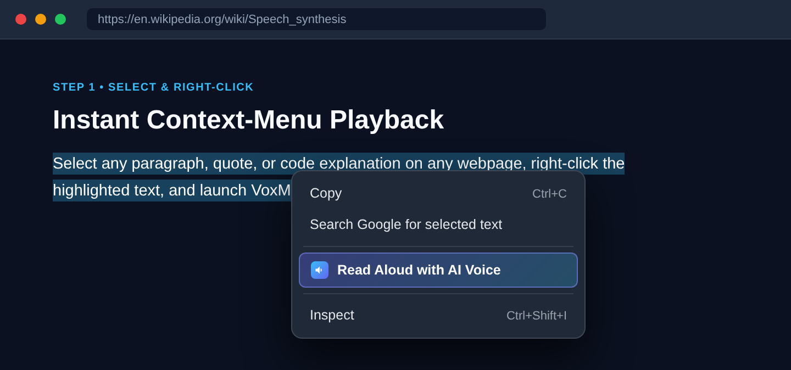
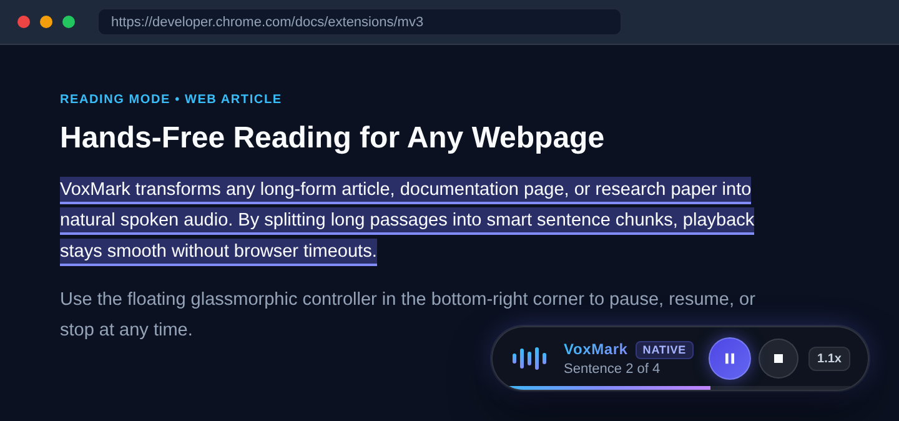

<div align="center">
  
  <h1>VoxMark AI</h1>
  <p><strong>Instant right-click text-to-speech for Chrome, Brave, and Edge.</strong></p>
  <p>Highlight any text on the web, right-click, and listen—with native offline voices or optional OpenAI Cloud TTS.</p>

  
  
  
</div>

---

## Overview

**VoxMark AI** turns any article, blog post, or documentation page into a hands-free listening experience. Built on **Manifest V3**, it works out of the box using your browser's native speech synthesis engine—and optionally supports **OpenAI Cloud TTS** (`tts-1` & `tts-1-hd`) when you want studio-grade AI voices.

## Screenshots

| 1. Right-Click Any Selection | 2. Floating Glassmorphic HUD | 3. Extension Settings Popup |
| :---: | :---: | :---: |
|  |  |  |
| *Highlight text and click **Read Aloud with AI Voice*** | *Play, pause, or stop with live progress* | *Switch engines, voices, speed, and pitch* |

## Key Features

- **Instant Right-Click Trigger:** Highlight any text on any webpage, right-click, and choose **Read Aloud with AI Voice**.
- **Dual TTS Engines:**
  - **Native Browser Mode:** Zero setup, zero API keys, and 100% local privacy.
  - **OpenAI Cloud Mode:** Optional `tts-1` and `tts-1-hd` models with 6 AI voices (`Nova`, `Alloy`, `Echo`, `Fable`, `Onyx`, `Shimmer`).
- **Floating Glassmorphism HUD:** On-page pill controller with animated audio visualizer, progress bar, Play/Pause, and Stop controls.
- **No 15-Second Chrome Freezes:** Automatically chunks long text by sentence boundaries and runs a speech watchdog to prevent Chrome TTS timeouts.
- **Smart Selection Reset:** Highlighting new text on the page automatically stops current playback and dismisses the HUD.
- **Voice, Speed & Pitch Controls:** Fine-tune playback speed (`0.75x`–`2.0x`), pitch (`0.8x`–`1.2x`), and preview voices right inside the popup.

## How to Install (Chrome, Brave & Edge)

Because VoxMark is a Manifest V3 extension, you can load it directly in under a minute:

1. **Download the repository:**
   - **ZIP:** Click the green **Code** button at the top of this repository → **Download ZIP**, then extract the folder.
   - **Git:**
     ```bash
     git clone [https://github.com/ziadkarem00/voxmark.git](https://github.com/ziadkarem00/voxmark.git)
     ```
2. **Open your browser's Extensions page:**
   - **Chrome:** `chrome://extensions`
   - **Brave:** `brave://extensions`
   - **Edge:** `edge://extensions`
3. Turn on **Developer mode** (toggle in the top-right corner).
4. Click **Load unpacked** and select the extracted `voxmark` folder (the one containing `manifest.json`).
5. *(Optional)* Click the puzzle-piece icon in your browser toolbar and **Pin** VoxMark AI for quick access to voice and speed settings.

## How to Use

1. Highlight any text on a webpage.
2. Right-click the selection and click **Read Aloud with AI Voice**.
3. Control playback from the **Floating HUD** in the bottom-right corner (Play/Pause, Stop, or highlight new text to stop).
4. Click the **VoxMark AI** toolbar icon anytime to switch between Native Browser and OpenAI Cloud modes, pick a voice, or adjust speed and pitch.

## How to Uninstall

1. Open your browser's Extensions page (`chrome://extensions`, `brave://extensions`, or `edge://extensions`).
2. Find **VoxMark AI - Read Aloud with AI Voice**.
3. Click **Remove** and confirm.

## Project Structure

```text
voxmark/
├── icons/
│   ├── icon16.png
│   ├── icon48.png
│   └── icon128.png
├── screenshots/
│   ├── context-menu.png
│   ├── floating-hud.png
│   └── popup-settings.png
├── background.js         # Context menu & dynamic script injection
├── content.css           # Floating HUD styles
├── content.js            # Sentence chunking, TTS engines & Shadow DOM HUD
├── manifest.json         # Manifest V3 configuration
├── popup.html            # Extension settings popup UI
├── popup.js              # Voice detection, preview & storage sync
└── README.md
